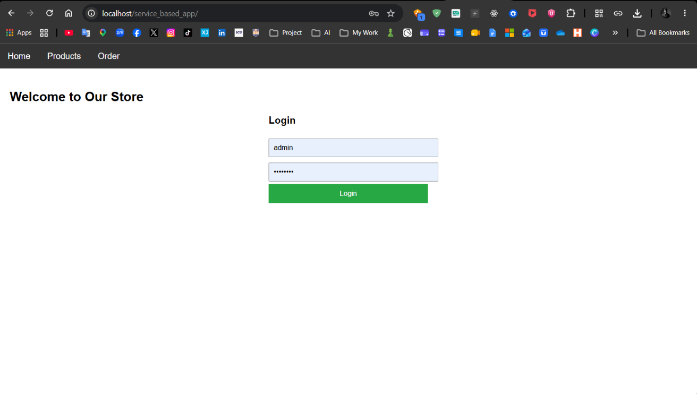

# Service-Based Store

A small service-based web application built with HTML, CSS, JavaScript, and PHP. It demonstrates separate services for authentication, product catalog data, and order processing with stock validation.

## Features

- Login using the demo account.
- Load products from the product service after login.
- Display product prices and available stock.
- Submit an order with a selected product and quantity.
- Confirm valid orders and report insufficient stock or unknown products.
- Navigate between the home, products, and order sections.

## Technology

- HTML5
- CSS3
- Vanilla JavaScript using the Fetch API
- PHP returning JSON responses
- Apache/PHP through XAMPP

## Project structure

```text
service_based_app/
├── css/
│   └── style.css
├── docs/
│   ├── DiscussionAndReflection.md
│   ├── LAB7-Additional-Task.md
│   └── Lab7-Manual.md
├── evidence/
│   ├── home-page.png
│   ├── login-confirmation-alert.png
│   ├── order-confirmation-alert.png
│   ├── place-an-order.png
│   └── product-catalog.png
├── images/
├── js/
│   └── app.js
├── services/
│   ├── auth_service.php
│   ├── order_service.php
│   └── product_service.php
└── index.html
```

## Running the application

1. Install [XAMPP](https://www.apachefriends.org/).
2. Copy this folder into `C:\xampp\htdocs\`.
3. Start the **Apache** module from the XAMPP Control Panel.
4. Open <http://localhost/service_based_app/> in a browser.

The PHP services must be accessed through Apache. Opening `index.html` directly from the file system will not execute the PHP endpoints.

## Demo login

```text
Username: admin
Password: password
```

These credentials are defined in `services/auth_service.php` for demonstration purposes only.

## Service endpoints

| Endpoint | Method | Purpose |
| --- | --- | --- |
| `services/auth_service.php` | `POST` | Validates the demo username and password |
| `services/product_service.php` | `GET` | Returns the product catalog and stock |
| `services/order_service.php` | `POST` | Validates stock and returns an order confirmation |

### Example order fields

```text
product_id: 1
quantity: 2
```

Successful orders return an order ID and remaining stock. Invalid quantities and unknown product IDs return an error message.

## Evidence

The screenshots in the [`evidence/`](evidence/) folder document the main application flows:



- [Login confirmation](evidence/login-confirmation-alert.png)
- [Product catalog](evidence/product-catalog.png)
- [Place an order](evidence/place-an-order.png)
- [Order confirmation](evidence/order-confirmation-alert.png)

## Important limitation

The product inventory is stored in a PHP array inside each request. Stock changes therefore do not persist between requests. A production implementation should use a shared database with transactional updates to prevent overselling when multiple orders are submitted at the same time.

## Related documentation

- [`docs/Lab7-Manual.md`](docs/Lab7-Manual.md) - lab instructions
- [`docs/LAB7-Additional-Task.md`](docs/LAB7-Additional-Task.md) - stock-management task
- [`docs/DiscussionAndReflection.md`](docs/DiscussionAndReflection.md) - architecture discussion and reflection
